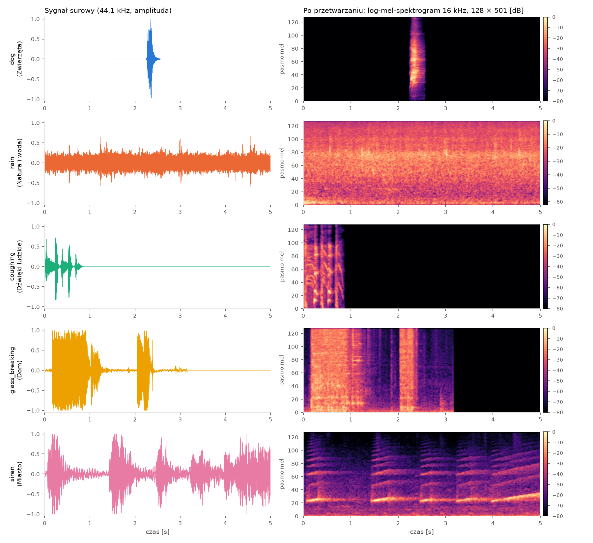

# Klasyfikacja dźwięków otoczenia

Klasyfikacja 50 rodzajów dźwięków otoczenia ze zbioru [ESC-50](https://github.com/karolpiczak/ESC-50) z użyciem sieci neuronowych w [PyTorch](https://pytorch.org/). Porównujemy dwa podejścia:

- **CNN 2D** na log-mel-spektrogramie,
- **1D-CNN + GRU** na surowym sygnale.



*Po jednym nagraniu z każdej grupy klas: sygnał surowy (po lewej) i log-mel-spektrogram, który trafia na wejście CNN (po prawej).*

**Skróty:** [Uruchomienie](#uruchomienie) · [Dane](#dane) · [EDA](#eksploracyjna-analiza-danych-eda) · [Dokumentacja](#struktura-dokumentacji)

## Uruchomienie

### Środowisko wirtualne

Linux / macOS:

```bash
python -m venv .venv
source .venv/bin/activate
```

Windows (PowerShell):

```powershell
python -m venv .venv
.venv\Scripts\Activate.ps1
```

### Instalacja zależności

```bash
pip install -r requirements.txt
```

`requirements.txt` instaluje PyTorch z CUDA 12.8 (wymagane dla kart RTX 50xx).

### Dane

Pobierz zbiór [ESC-50](https://github.com/karolpiczak/ESC-50) i rozpakuj go tak, aby powstał folder `data/ESC-50-master/` (z podfolderami `audio/` i `meta/`). Zawartość `data/` nie jest śledzona przez git.

### Sprawdzenie danych i podziału na zbiory

```bash
python src/dane.py
```

Skrypt wypisuje liczbę nagrań w zbiorach trening/walidacja/test, brakujące pliki audio oraz kontrolę wycieku nagrań źródłowych między zbiorami.

### Eksploracyjna analiza danych (EDA)

Skrypty uruchamiamy po kolei z głównego folderu repozytorium:

```bash
python src/eda_jakosc.py          # skan jakości plików audio
python src/eda_etykiety.py        # rozkład klas, grup i zbiorów
python src/eda_wizualizacje.py    # spektrogramy, cechy, PCA / t-SNE / UMAP, Isolation Forest
```

Tabele zapisują się w `docs/eda/`, wykresy w `docs/figures/eda/`.

## Struktura dokumentacji

- `docs/zajecia/PR-0X/` – dokumentacja z kolejnych zajęć projektowych,
- `docs/eda/`, `docs/figures/eda/` – wyniki EDA (tabele i wykresy).
